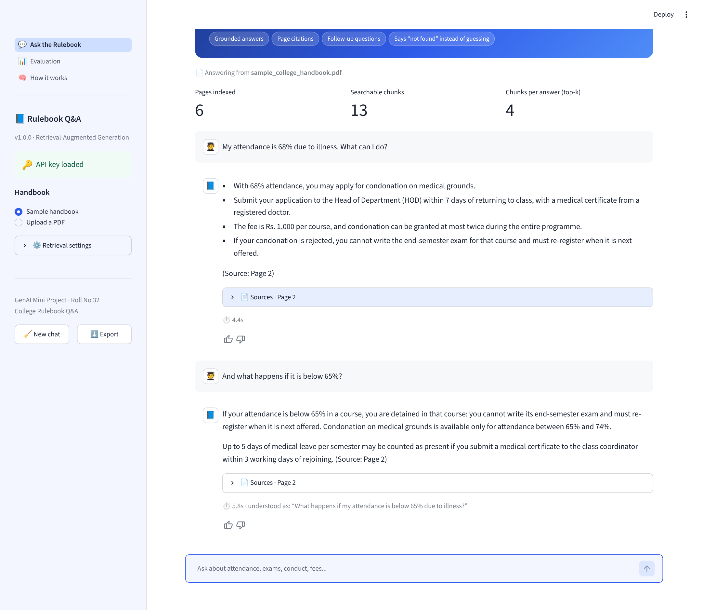
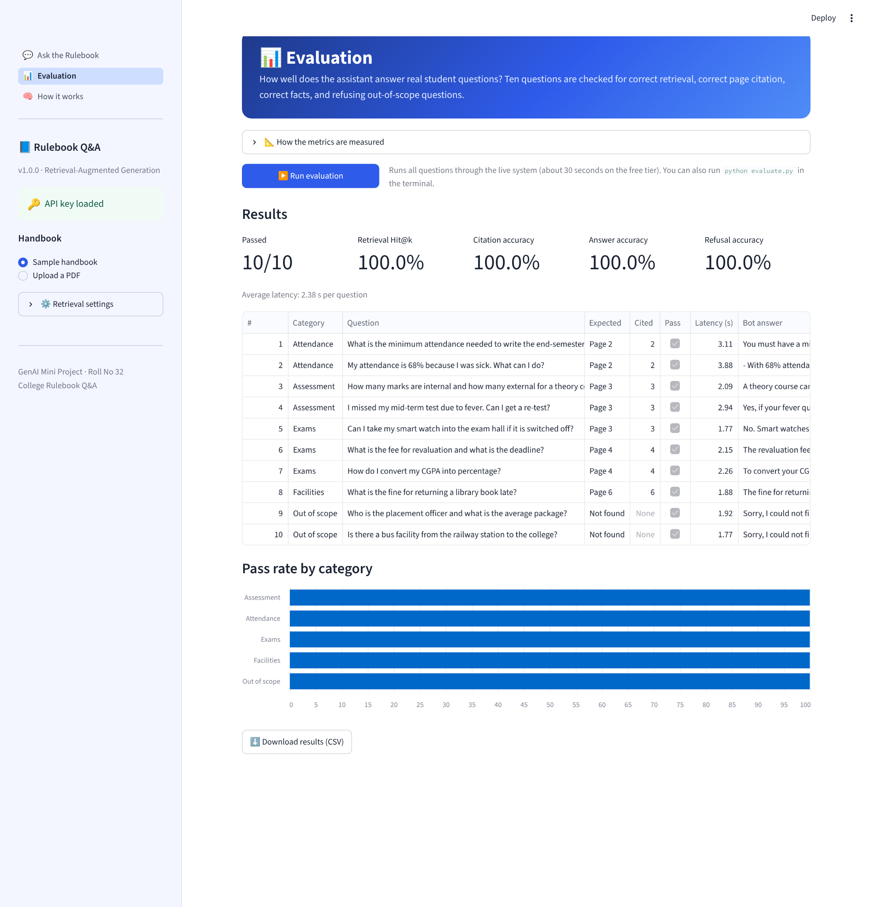
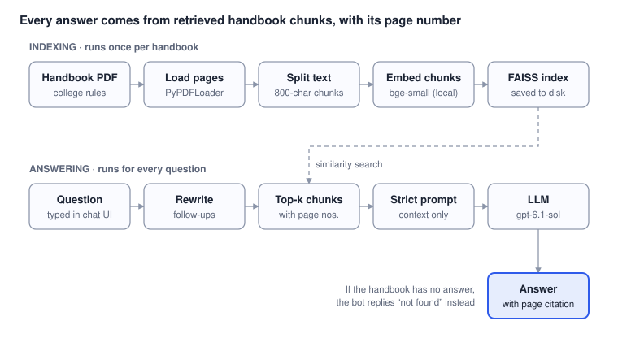

# 🎓 College Rulebook Q&A

**A Retrieval-Augmented Generation (RAG) assistant that answers students' questions from the college handbook, with page citations.**

      

> GenAI (LLM) Mini Project · **PS 32** · Prathamesh Prashant Bairagi · Roll No 32 · LY CORE 4

---

## 📌 Problem statement

Students rarely read the college handbook, so they miss rules on attendance, exams and conduct until it is too late.
This project builds a Q&A system over the handbook (attendance, exams, conduct) that:

- answers **only from the handbook**, never from the LLM's general knowledge,
- shows the **page number** for every answer so students can verify it,
- replies **"not found"** when the handbook does not cover a question, instead of guessing.

## 📸 Screenshots

| Chat: answer with page citation | Evaluation dashboard |
|---|---|
|  |  |

More screenshots: [home](screenshots/1_home.png) · [source passages](screenshots/3_sources.png) · [not found](screenshots/4_not_found.png)

## ✨ Features

| | Feature |
|---|---|
| 💬 | Chat interface with history, suggested questions by category, and chat export |
| 📄 | Page citations, with the retrieved handbook passages shown as source cards |
| 🔁 | Follow-up questions ("and for practicals?") rewritten into full questions before search |
| 🚫 | Fixed "not found" reply for out-of-scope questions (hallucination guard) |
| 🧹 | Automatic removal of repeated headers and footers before indexing |
| ⚡ | FAISS index cached per handbook, so each PDF is embedded only once |
| 📤 | Upload any college's handbook PDF |
| 📊 | Built-in evaluation dashboard: Hit@k, citation, answer and refusal accuracy, latency |
| 👍 | Thumbs up / down feedback saved to `logs/feedback.csv` |
| ✅ | 19 automated tests that run offline (no API key needed) |

## 🏗️ Architecture



1. **Indexing:** the PDF is loaded, repeated headers and footers are removed, the text is split into chunks, embedded locally with bge-small-en-v1.5 (FastEmbed) and stored in FAISS.
2. **Answering:** follow-ups are rewritten as full questions, FAISS returns the top-k chunks, and the LLM answers from those chunks only, citing the page.

## 🧰 Tech stack

| Layer | Tool |
|---|---|
| UI | Streamlit (multi-page: Chat, Evaluation, How it works) |
| Orchestration | LangChain |
| PDF loading | `PyPDFLoader` |
| Chunking | `RecursiveCharacterTextSplitter` |
| Embeddings | `BAAI/bge-small-en-v1.5` via FastEmbed (free, local, no key) |
| Vector store | FAISS |
| LLM | `gpt-6.1-sol` via an OpenAI-compatible API, temperature 0 (Gemini also supported) |
| Testing | pytest + a 10-question evaluation set |

## 📁 Project structure

```
college-rulebook-qa/
├── app.py                     # Streamlit entry point (navigation + sidebar)
├── evaluate.py                # CLI: run the evaluation set
├── views/
│   ├── chat.py                # 💬 Ask the Rulebook
│   ├── evaluation.py          # 📊 Evaluation dashboard
│   └── about.py               # 🧠 How it works
├── rulebook_qa/               # Core package
│   ├── config.py              # Settings (from .env)
│   ├── ingest.py              # Load PDF, remove boilerplate, split into chunks
│   ├── vectorstore.py         # Embeddings + FAISS index with disk cache
│   ├── prompts.py             # Answer and follow-up prompts
│   ├── qa.py                  # RulebookQA engine: condense, retrieve, answer, cite
│   ├── evaluation.py          # Metrics and result reports
│   ├── feedback.py            # Feedback logging
│   └── ui.py                  # Shared Streamlit styling and sidebar
├── data/
│   ├── sample_college_handbook.pdf   # 6-page demo handbook (fictional college)
│   └── eval_questions.json           # 10 test questions with expected pages
├── tests/                     # Offline pytest suite
├── .streamlit/config.toml     # Theme
├── requirements.txt
├── Dockerfile
└── .env.example
```

## 🚀 Getting started

```bash
# 1. Create a virtual environment and install dependencies
python -m venv venv
venv\Scripts\activate            # Windows  (macOS/Linux: source venv/bin/activate)
pip install -r requirements.txt

# 2. Add your API key
copy .env.example .env           # macOS/Linux: cp .env.example .env
#    then open .env and paste your key into OPENAI_API_KEY

# 3. Run the app
streamlit run app.py
```

Open http://localhost:8501, choose **Sample handbook** or upload your own PDF, and start asking.

**Docker (optional)**
```bash
docker build -t rulebook-qa .
docker run -p 8501:8501 --env-file .env rulebook-qa
```

## 📊 Evaluation

The system is tested on 10 realistic student questions (`data/eval_questions.json`): 8 answerable from the handbook,
and 2 deliberately out of scope.

```bash
python evaluate.py
```

| Metric | What it checks |
|---|---|
| Retrieval Hit@k | The page with the answer is in the top-k retrieved chunks |
| Citation accuracy | The answer cites the correct page |
| Answer accuracy | The answer contains the key facts (e.g. "75%", "Rs. 700") |
| Refusal accuracy | Out-of-scope questions get "not found" |
| Avg latency | Seconds per answer |

**Results (gpt-6.1-sol, sample handbook):**

| Passed | Retrieval Hit@4 | Citation accuracy | Answer accuracy | Refusal accuracy | Avg latency |
|---|---|---|---|---|---|
| 10/10 | 100.0% | 100.0% | 100.0% | 100.0% | 2.38 s |

Full per-question results: [`evaluation/results.md`](evaluation/results.md). They are also shown on the **📊 Evaluation** page of the app.

## ✅ Tests

```bash
pytest -q
```

The 19 tests use a local keyword embedding and a fake LLM, so they run offline in about 2 seconds. They cover PDF
loading, boilerplate removal, chunking, retrieval of the right page for every evaluation question, index caching,
citation parsing, not-found handling, follow-up rewriting and the evaluation pipeline.

## 💡 Example (real output)

> **Student:** My attendance is 68% because I was sick. What can I do?
>
> **Assistant:**
> - With 68% attendance, you may apply for condonation on medical grounds.
> - Submit your application to the Head of Department (HOD) within 7 days of returning to class, with a medical certificate from a registered doctor.
> - The condonation fee is Rs. 1,000 per course, and condonation can be granted at most twice during the entire programme.
> - If your condonation is rejected, you cannot write the end-semester exam for that course and must re-register when it is next offered.
>
> (Source: Page 2)

## ⚠️ Limitations and future work

- Scanned PDFs need OCR first (no text layer).
- Rules inside complex tables may be split across chunks.
- Answers depend on the API provider being available; a local model via Ollama could be added as a fallback.
- **Next steps:** hybrid search (BM25 + vectors), Hindi and regional-language answers, an admin page to update the
  handbook each year.

## 🛠️ Troubleshooting

| Problem | Fix |
|---|---|
| `404 model not found` | Set a model your provider offers in `CHAT_MODEL` in `.env` |
| `429 rate limit` | Wait a minute, or raise `--pause` in `evaluate.py` |
| Old answers after changing the PDF | Delete the `faiss_index/` folder |

---

*The sample handbook describes a fictional college and is for demonstration only.*
